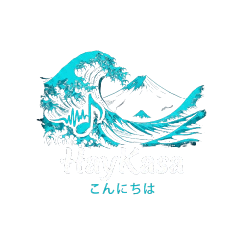

<div align="center">
  

  # HayKasa

  **Music discovery, queues, playlists, and playback for web, Windows, and an Android preview app.**

  [](./package.json)
  [](./package.json)
  [](./desktop/README.md)
  [](./android/README.md)
  [](https://github.com/6NCLegend9/Spotify-clone/actions/workflows/ci.yml)

  [Open HayKasa](https://haykasa.vercel.app) · [Releases](https://github.com/6NCLegend9/Spotify-clone/releases) · [Android](./android/README.md) · [Windows](./desktop/README.md) · [Documentation](#documentation)
</div>

---

HayKasa combines a Next.js music application with YouTube-backed discovery/playback, personal libraries, queue controls, account-aware recommendations, synchronized lyrics/captions, Jam sessions, a Windows desktop shell, and an Android WebView/Media3 preview.

## Product preview

<div align="center">
  
</div>

The preview is a repository-owned brand image. UI screenshots and dated verification reports are linked in the [documentation index](#documentation).

## What HayKasa includes

- **Search and discovery** — song, artist, and playlist results with filters, pagination, deduplication, and direct artist-channel links. Query submission stays on the search index. The homepage balances familiar recommendations with exploration using favorite genres/artists and listening/search activity.
- **Queue-first playback** — play next, append, reorder/remove, queue persistence, recovery from provider failures, repeat/shuffle controls, and a responsive expanded player.
- **Library tools** — liked songs, user playlists, collaborators, public/private access controls, listening history, followed artists, and playlist browsing.
- **Lyrics and captions** — synchronized lyric/caption surfaces tied to the active player.
- **HayKasa Jam** — signed realtime session events, host/guest roles, shared playback state, AUX controls, persistent rooms, and QR/link sharing.
- **Responsive UI** — desktop multi-panel shell, mobile tab navigation, bottom player, expanded media, keyboard/media-session controls, reduced-motion support, and accessibility settings.
- **Windows desktop** — sandboxed Electron shell, system-browser auth, Discord Desktop IPC, tray/startup controls, appearance profiles, diagnostics, safe mode, and a signing-gated native updater.
- **Android** — the production mobile interface in a restricted WebView, native Media3 playback for successfully resolved audio, safe screen insets, media controls, Back navigation, document-picker uploads, renderer-crash recovery, and Google Play update prompts for store installs.

## Platform status and playback limits

| Component | Status and requirements |
| --- | --- |
| Web / PWA | The primary application. YouTube embedding remains subject to provider restrictions; background playback is not guaranteed by installing a PWA. |
| Windows | Web changes arrive through the production website. Native updates require a published, complete signed release and configured signing credentials. See [release setup](./desktop/README.md#release-configuration-check). |
| Android | This branch builds Android 1.0.2 (version code 3) as a debug preview or release AAB; the separately published APK can be older. The standard APK always loads `https://haykasa.vercel.app`, including when downloaded through localhost. Web changes need deployment; native changes need a new build. Play installs check for published native updates on foreground entry; sideloaded previews do not auto-update. See [build and activation requirements](./android/README.md). |
| Source audio / yt-dlp | Optional for authenticated mobile audio. The hosted retest passed storage and signed range delivery, but YouTube rejected extraction with `source_access_restricted`. Production source playback remains disabled; see the dated [live verification results](./docs/qa/vercel-media/RESULTS.md). |

Android's native service can continue a resolved audio asset outside the WebView. Embedded YouTube remains a foreground fallback. Native notification next/previous is not implemented. Reliable suspended-WebView queue continuation, process restoration, and physical-device battery behavior are not established by the controlled emulator tests.

## Architecture

```text
Browser / PWA
    |
    v
Next.js 15 App Router on Vercel
    |
    +--> API routes / auth / recommendation services
    |        |
    |        +--> MongoDB / Mongoose
    |        +--> YouTube APIs
    |        +--> Supabase Realtime for Jam transport
    |
    +--> Redux client state + player controllers
             |
             +--> YouTube embedded playback / local media surfaces
             +--> authenticated mobile source resolver
                       |
                       +--> optional yt-dlp / FFmpeg media service
                       +--> signed, seekable audio assets

Windows Desktop
    |
    +--> hardened Electron main + preload boundary
    |
    +--> loads https://haykasa.vercel.app
    |
    +--> /api/desktop/manifest + /api/desktop/update/*
              |
              +--> validated public GitHub Release assets

Android Preview
    |
    +--> trusted production WebView + restricted message bridge
    +--> native Media3 service for resolved source audio
    +--> foreground embedded-player fallback when source audio is unavailable
```

The native shells reuse the web product and its authenticated APIs. They add platform capabilities while server credentials stay on the backend.

## Windows desktop and updates

Already-installed desktop builds use stable HayKasa compatibility endpoints:

```text
HayKasa Desktop
  -> https://haykasa.vercel.app/api/desktop/manifest
  -> https://haykasa.vercel.app/api/desktop/update/<channel>/latest.yml
  -> public GitHub Release assets
  -> electron-updater
  -> Windows Authenticode verification
```

That indirection lets existing clients receive a new native release even when the artifact origin changes. Stable/beta releases are versioned GitHub Releases with a complete updater bundle (`latest.yml`, versioned installer, blockmap, and authenticated release manifest). The server fails closed when a bundle is incomplete or its signed manifest does not match the public release assets.

See [desktop/README.md](./desktop/README.md) for the native security boundary, release channels, signing model, staged rollout, and operational controls.

## Tech stack

| Layer | Main technologies |
| --- | --- |
| Web | Next.js 15, React 18, Tailwind CSS, Framer Motion |
| Client state | Redux Toolkit, Redux Persist |
| Auth | NextAuth, bcrypt, Google OAuth |
| Data | MongoDB, Mongoose |
| Playback/discovery | YouTube APIs / `youtubei.js`, browser media APIs |
| Optional source service | Python, yt-dlp, FFmpeg, Vercel Services/private Blob or single-instance Docker |
| Realtime | Supabase Realtime with server-signed Jam events |
| Desktop | Electron, electron-builder, electron-updater |
| Android | Java, Android WebView, AndroidX Media3, Gradle |
| Code checks | ESLint, TypeScript, production builds |
| Deployment | Vercel + GitHub Actions + GitHub Releases |

## Requirements

- Node.js **22.x**
- npm
- MongoDB
- SMTP credentials for account email flows
- optional integration configuration described in [.env.example](./.env.example); Google sign-in is currently disabled by `GOOGLE_SIGN_IN_ENABLED` in [site configuration](./src/utils/siteConfig.js), in addition to requiring credentials

Windows desktop development additionally requires the normal Electron/electron-builder platform prerequisites. Stable/beta publication requires the protected signing secrets documented in [desktop/README.md](./desktop/README.md).

Android builds require JDK 21, Android SDK platform 36, and build tools 36.0.0. The app supports Android 6.0+; emulator checks target Android 13 and Android 16. See [Android prerequisites](./android/README.md#build-and-install).

## Local development

Clone the repository and install the locked dependencies:

```sh
git clone https://github.com/6NCLegend9/Spotify-clone.git
cd Spotify-clone
npm ci
```

Copy the environment template:

```sh
cp .env.example .env.local
```

For local auth, keep the app and NextAuth on the same loopback origin:

```dotenv
NEXTAUTH_URL=http://localhost:3000
NEXT_PUBLIC_APP_URL=http://localhost:3000
```

Start the web app:

```sh
npm run dev
```

Open `http://localhost:3000`.

### Desktop development

From the repository root:

```powershell
npm run desktop:install
npm run desktop:dev
```

The development command starts the local web renderer and Electron together.
Use `npm run desktop` to launch the production renderer instead.

Windows installer build, also from the root:

```powershell
npm run desktop:build
```

`desktop:pack` creates an unpacked Windows application. `desktop:build` writes
the NSIS installer to `desktop/dist/`; root `build` builds only the web app.
Packaging does not publish downloads or updates. Public desktop releases use
the protected signed-release workflow.

### Android development

Use **Download for Android** in Settings to obtain the newest validated public preview. The card shows its source build/date; the legacy [PR35 preview](https://github.com/6NCLegend9/Spotify-clone/releases/download/android-preview/HayKasa-Android.apk) remains available as a fallback and can be older than this branch. See [public preview downloads](./android/README.md#public-preview-download).

Samsung Auto Blocker can show **Unknown app blocked** for this APK because it is installed outside approved app stores. Use the browser without an APK, or review the [Samsung installation guidance](./android/README.md#samsung-unknown-app-blocked). APK signing alone does not remove this phone policy.

After installing the Android prerequisites, run from the repository root:

```sh
npm run android:check
npm run android:build
npm run android:bundle
```

The debug APK is written to `android/app/build/outputs/apk/debug/app-debug.apk`; the bundle command writes `android/app/build/outputs/bundle/release/app-release.aab`. Without release-signing configuration the AAB is unsigned and cannot be uploaded to Play. The [Android workflow](./.github/workflows/android-ci.yml) uploads the debug APK, unsigned review bundle, and device reports. The manual [Play Store bundle workflow](./.github/workflows/android-play-store.yml) uses protected upload-key secrets to produce a verified signed AAB. See [Play Store release setup](./android/README.md#play-store-release-bundle) before distribution.

The [Publish Android Preview workflow](./.github/workflows/android-preview-release.yml) waits for a successful main APK build and Android 13/16 emulator checks, then publishes an immutable source-SHA preview. Settings selects the newest validated versioned release; older APKs are preserved. Preview APKs still require manual installation. See the [playback and session audit](./docs/qa/android-playback-audit-2026-10-20.md) and [main production website/Windows/Android audit](./docs/qa/production-audit-2026-10-20.md). Dedicated [Windows](./.github/workflows/desktop-production-smoke.yml) and [Android](./.github/workflows/android-production-qa.yml) production checks install the actual public downloads and preserve screenshots and diagnostic artifacts.

### Optional media service

Use the [media service guide](./media-service/README.md) for a single-instance Docker deployment or the [Vercel deployment guide](./docs/qa/vercel-media/README.md) for the stateless service and private Blob storage. Keep resolver credentials server-side. A successful live extraction, download, and decode is required before enabling source playback.

The [audio fidelity checks](./docs/qa/audio-quality/README.md) cover automatic Opus/AAC selection, packet-preserving remux, delivered quality metadata and shared browser sound processing. Native source eligibility includes signed-in web, desktop and Android; production activation remains gated on successful live verification.

## Verification

Run the web gate:

```sh
npm run check
```

That executes ESLint, Next.js-generated type checks, TypeScript validation, and a production Next.js build. Additional workflows run the focused regression, browser, security, native, and packaging checks below.

| Checks | Entry point |
| --- | --- |
| Production dependency audit and web/regression gates | [CI workflow](./.github/workflows/ci.yml) |
| Security, authorization, file/media fuzz fixtures and worker checks | [Security regression workflow](./.github/workflows/security-regression.yml) |
| Desktop/mobile homepage, panel layout, search, and player Skip/error behavior | [Homepage/browser workflow](./.github/workflows/home-discovery-vm.yml) |
| Mobile background-playback browser checks | [Mobile playback workflow](./.github/workflows/mobile-playback-vm.yml) |
| Playlist spacing and duration browser checks | [Playlist workflow](./.github/workflows/playlist-duration-vm.yml) |
| Android bridge/resolver, unit/lint/APK/AAB builds and Android 13/16 instrumentation | [Android workflow](./.github/workflows/android-ci.yml) and [QA fixtures](./docs/qa/android/) |
| Signed Android App Bundle for owner upload to Play Console | [Manual Play Store workflow](./.github/workflows/android-play-store.yml) |
| Desktop contract and native checks | [Desktop CI](./.github/workflows/desktop-ci.yml) |
| Windows packaging | [Desktop package CI](./.github/workflows/desktop-package-ci.yml) |
| Unsigned desktop preview artifacts | [Desktop preview workflow](./.github/workflows/desktop-preview.yml) |

Browser and emulator media fixtures use controlled APIs/audio. Passing them does not prove live YouTube extraction, physical-device behavior, or production credentials. Consult each report's date and scope.

## Production and release operations

Production configuration, deployment validation, caching, service-worker behavior, and operational checks are documented in [PRODUCTION.md](./PRODUCTION.md).

The [desktop release workflow](./.github/workflows/desktop-release.yml) attempts an automatic stable release after pushes to `main` and also supports manual channel/version selection:

- **stable** — signed, non-prerelease, `desktop-vX.Y.Z`, main branch only
- **beta** — signed GitHub prerelease, `desktop-beta-vX.Y.Z[-suffix]`
- **internal** — unsigned GitHub prerelease for testing, `desktop-internal-vX.Y.Z[-suffix]`

The stable/beta workflow verifies the Windows Authenticode signature before a public GitHub Release is created and verifies the published updater assets after release.

Check signing configuration with `npm run desktop:release:check`. Automatic and manual signed releases fail before building when signing inputs are missing or invalid, with a diagnostic naming the blocked configuration. No installer is published by a blocked run. Building an unsigned preview does not enable stable automatic updates. See [signing setup](./desktop/README.md#release-configuration-check) and the [desktop recovery guide](./docs/qa/desktop-production-recovery.md).

## Security principles

HayKasa's security-sensitive paths are designed to fail closed:

- stale/revoked account sessions are rejected before private reads or writes;
- password-reset tokens are one-time and revoke previous sessions;
- playlist access and collaboration are authorization-checked server-side;
- Jam realtime commands are server-authorized, signed, replay-protected, and role-scoped;
- the Electron renderer is sandboxed and receives only a narrow preload API;
- the Android bridge accepts only trusted-origin main-frame messages and validated asset URLs;
- stable/beta desktop releases require both authenticated release metadata and valid Windows code signing;
- native updater, policy, Discord, and diagnostics failures are isolated from normal music playback.

For deeper operational detail, see [desktop/README.md](./desktop/README.md), [PRODUCTION.md](./PRODUCTION.md), and the focused documents under [`docs/`](./docs/).

## Documentation

This index links every other tracked Markdown document in the repository. Dated reports, plans, and design snapshots record their original scope; they can describe older behavior. Use current code and newer verification results when references differ.

### Setup, platforms, and operations

- [Production configuration, authentication, database, and rollout checklist](./PRODUCTION.md)
- [Android build, installation, native playback, and verification limits](./android/README.md)
- [Windows architecture, security boundary, updater, signing, and release setup](./desktop/README.md)
- [Media service architecture and single-instance Docker setup](./media-service/README.md)
- [Genre system and recommendation configuration](./GENRE_SYSTEM.md)
- [Local DevTools security and performance audit guide](./DEVTOOL_AUDIT_GUIDE.md)
- [QA audit and refactor log](./TODO.md)
- [Legacy development-only Discord bridge](./desktop-bridge/README.md)

### Implementation, reliability, and performance

- [Provider reliability and shared metadata caching](./docs/backend-reliability.md)
- [Player architecture and implemented features](./docs/PLAYER_OVERHAUL.md)
- [Motion performance and interaction checks](./docs/motion-performance.md)
- [Performance review](./docs/PERFORMANCE_REVIEW.md)
- [Home background image sources and licenses](./docs/HOME_BACKGROUND_LICENSES.md)
- [P1 audit remediation notes](./docs/AUDIT_P1_FIXES.md)
- [Guest search and playback investigation](./docs/GUEST_SEARCH_PLAYBACK_FIX.md)
- [Original QA findings](./docs/QA_FINDINGS.md)
- [Retired audio-engine prototype and cleanup record](./docs/AUDIO_ENGINE_PHASE1.md)

### QA guides, audits, and verification reports

- [Balanced homepage discovery and deduplication](./docs/qa/home-discovery/README.md)
- [Artist channel layout and navigation](./docs/qa/artist-profile.md)
- [Playlist row spacing and saved durations](./docs/qa/playlist-duration/README.md)
- [Authenticated background-playback policy and checks](./docs/qa/background-playback/README.md)
- [Mobile source playback selection and validation](./docs/qa/mobile-source-playback/README.md)
- [Vercel media deployment and infrastructure verification](./docs/qa/vercel-media/README.md)
- [Worker inventory, bindings, and activation gates](./docs/qa/vercel-media/WORKERS.md)
- [Dated hosted extraction, storage, and delivery results](./docs/qa/vercel-media/RESULTS.md)
- [Production desktop release and updater recovery](./docs/qa/desktop-production-recovery.md)
- [Robustness, corruption/fuzzing, and security audit report](./docs/qa/security-audit/REPORT.md)
- [Security audit remediation record](./docs/qa/security-audit/FIXES.md)
- [PR23 responsive UI verification ledger](./docs/qa/pr23-ui-redesign.md)
- [PR24 artist-page verification](./docs/qa/pr24-spotify-artist.md)
- [PR25 duration and desktop verification](./docs/qa/pr25-duration-desktop.md)
- [PR28 artist links and search navigation](./docs/qa/pr28-artist-links.md)
- [PR28 playlist creation and presentation](./docs/qa/pr28-playlists/README.md)
- [PR28 music interface changes](./docs/qa/pr28-spotify-ui.md)
- [PR28 Windows desktop update preparation](./docs/qa/pr28-windows-desktop.md)

### Historical implementation plans

- [2026-09-24 — PR #19 Unified Web/Desktop + Performance Implementation Plan](./docs/superpowers/plans/2026-09-24-pr19-unified-web-desktop-performance.md)
- [2026-09-26 — PR19 Desktop Release and Runtime Hardening Implementation Plan](./docs/superpowers/plans/2026-09-26-pr19-desktop-release-runtime-hardening.md)
- [2026-09-26 — PR19 Final Integration and Verification Implementation Plan](./docs/superpowers/plans/2026-09-26-pr19-final-integration-verification.md)
- [2026-09-26 — PR19 Playback and Responsive Hardening Implementation Plan](./docs/superpowers/plans/2026-09-26-pr19-playback-responsive-hardening.md)
- [2026-09-26 — PR19 Playlist, Performance, and Domain Cleanup Implementation Plan](./docs/superpowers/plans/2026-09-26-pr19-playlist-performance-cleanup.md)
- [2026-09-26 — PR19 Search and Radio Rate-Limit Implementation Plan](./docs/superpowers/plans/2026-09-26-pr19-search-radio-rate-limits.md)
- [2026-09-26 — PR19 System Hardening Execution Index](./docs/superpowers/plans/2026-09-26-pr19-system-hardening-index.md)
- [2026-10-06 — HayKasa Responsive UI Redesign Implementation Plan](./docs/superpowers/plans/2026-10-06-pr23-responsive-ui-redesign.md)
- [2026-10-10 — HayKasa yt-dlp Playback Implementation Plan](./docs/superpowers/plans/2026-10-10-ytdlp-playback.md)

### Historical design specifications

- [2026-09-23 — HayKasa Desktop Updates + README Refresh — Design](./docs/superpowers/specs/2026-09-23-desktop-updater-github-releases-readme-design.md)
- [2026-09-24 — PR #18 Roadmap Design: Capability Truthfulness, Audio Visualizer, and Playback Diagnostics](./docs/superpowers/specs/2026-09-24-pr18-roadmap-design.md)
- [2026-09-24 — PR #19 Design — One HayKasa Product Codebase Across Web and Desktop](./docs/superpowers/specs/2026-09-24-pr19-unified-web-desktop-performance-design.md)
- [2026-09-26 — PR #19 System Hardening Design](./docs/superpowers/specs/2026-09-26-pr19-system-hardening-design.md)
- [2026-10-06 — PR23: HayKasa responsive interface redesign](./docs/superpowers/specs/2026-10-06-pr23-responsive-ui-redesign-design.md)
- [2026-10-10 — HayKasa yt-dlp playback design](./docs/superpowers/specs/2026-10-10-ytdlp-playback-design.md)

### Historical source-playback verification

- [PR28 source playback verification — 2026-10-10](./docs/superpowers/verification/2026-10-10-ytdlp-playback.md)

### Design-tool reference snapshots

These files include older palette and component references. The implemented styles and components determine the current interface.

- [HayKasa interface system](./.superdesign/design-system.md)
- [Shared UI primitives](./.superdesign/init/components.md)
- [Extractable Superdesign DraftComponents](./.superdesign/init/extractable-components.md)
- [Shared layout components](./.superdesign/init/layouts.md)
- [Key page dependency trees](./.superdesign/init/pages.md)
- [HayKasa routes](./.superdesign/init/routes.md)
- [HayKasa theme tokens](./.superdesign/init/theme.md)

### Executable QA and screenshot collections

- [Android bridge, resolver, player, and emulator fixtures](./docs/qa/android/)
- [Android download and installation-help browser checks](./docs/qa/android-installation/)
- [Search browser scenarios](./docs/qa/search/)
- [Desktop and mobile panel scenarios](./docs/qa/desktop-panels/)
- [Integration-conflict checks](./docs/qa/integration-conflicts/)
- [Security audit fixtures and evidence](./docs/qa/security-audit/)
- [Artist-profile screenshots](./docs/qa/artist-profile/)
- [Responsive UI screenshots](./docs/qa/pr23-ui/)

## Authorship and license

Original contributions and modifications authored by **6NCLegend9 and collaborators** remain the copyright of their respective authors and are released under the [MIT License](./LICENSE).

Include [LICENSE](./LICENSE) when redistributing the software. Third-party dependencies and media retain their respective licenses.

---

<div align="center">
  
  <br />
  <strong>HayKasa — music lives here.</strong>
</div>
